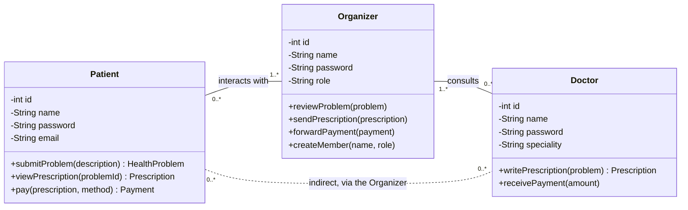
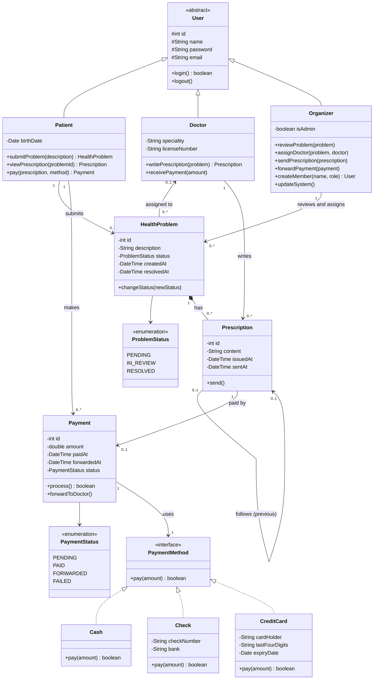
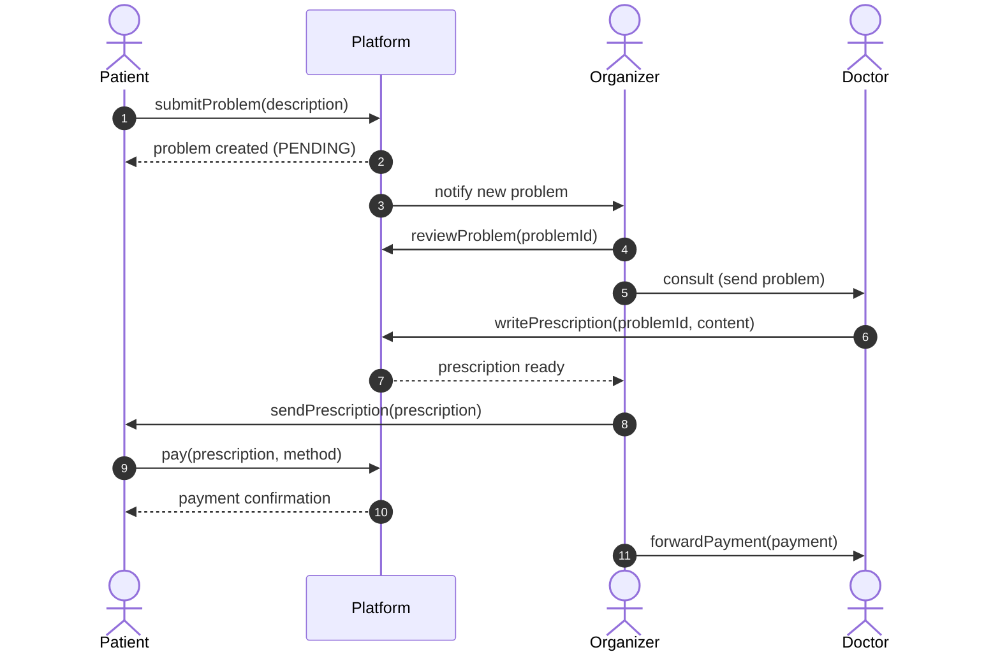
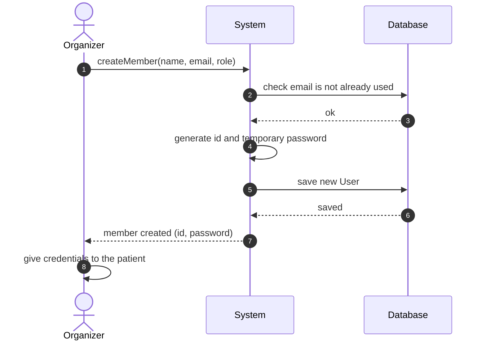
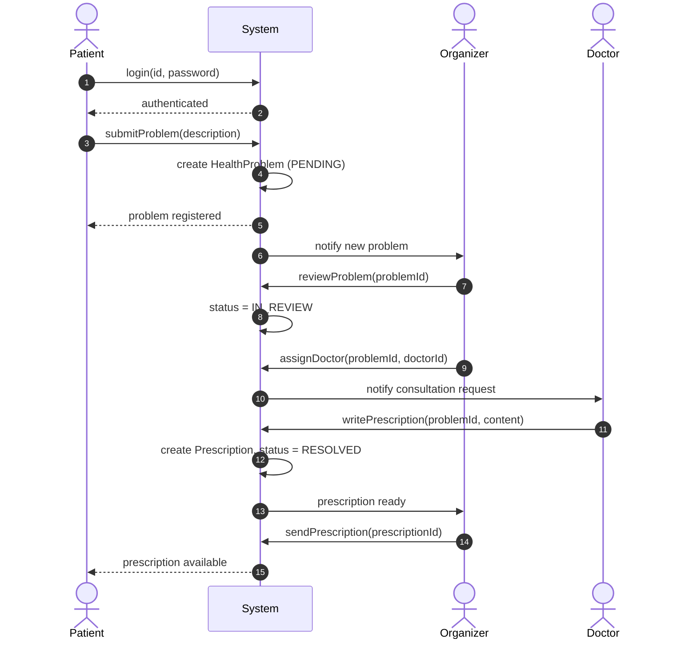
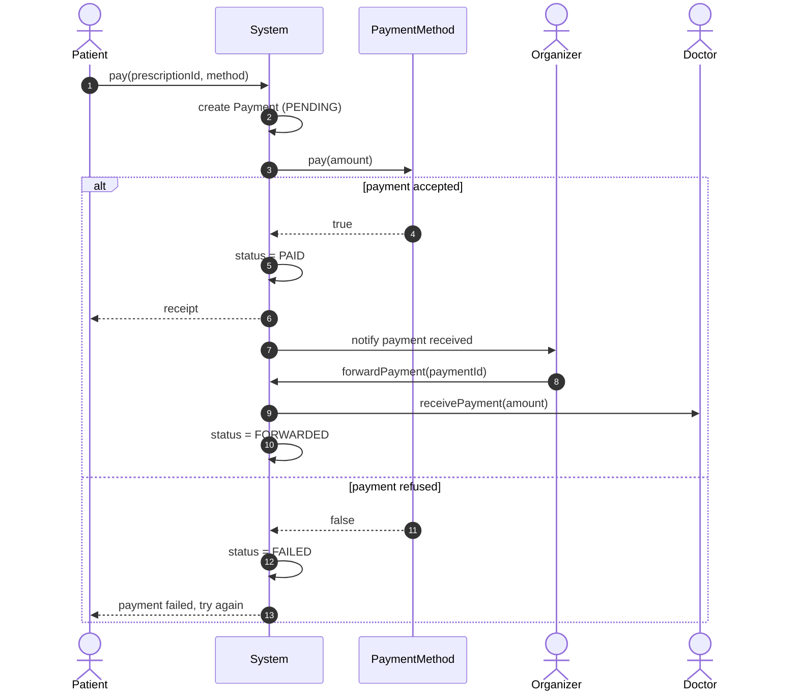

# Hospital Management System: UML

GitHub renders the Mermaid blocks below automatically.

---

## Task 1: Basic class diagram

---

## Task 2 and 3: Complete class diagram

---

## Task 2: Sequence diagram (submit, prescription, payment)

---

## Task 3: System sequence diagrams

### 1. Patient registration (Organizer creates a new member)

### 2. Consultation flow (problem submission to prescription delivery)

### 3. Payment processing (patient pays, organizer forwards to doctor)

---

## Questions to consider

1. **Several doctors for one patient:** the Organizer can assign several doctors to the same problem, or a patient can submit several problems each handled by a different doctor. For a richer model, add a `Consultation` association class between `HealthProblem` and `Doctor` (with date and opinion).
2. **Reusable prescriptions:** keep a `PrescriptionTemplate`, or link a new prescription to the previous one (the `follows` relation above) so the history stays traceable.
3. **Design pattern for payments:** the **Strategy** pattern. `PaymentMethod` is the strategy interface, and `Cash`, `Check` and `CreditCard` are interchangeable implementations.
4. **Data integrity:** run each payment in a database transaction (all or nothing), use a unique payment id to avoid double charging, check that the amount matches the prescription, and keep the `PaymentStatus` transitions strict (PENDING to PAID to FORWARDED).
